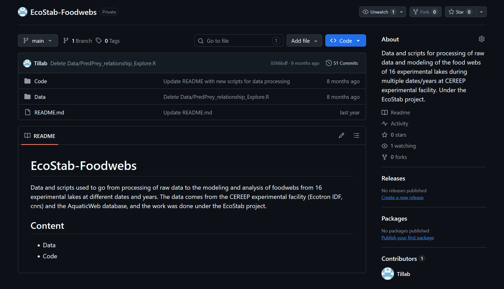

# Tillab.github.io
Mon portfolio professionnel

## Projets sélectionnés
### Détectez des faux billets avec Machine Learning

##### Contexte et démarche
L’Organisation nationale de lutte contre le faux-monnayage (ONCFM, organisation fictive) cherche à améliorer l’identification des faux billets. À partir d’un jeu de données de 1 500 billets scannés, dont l’authenticité était connue, j’ai entraîné et évalué plusieurs algorithmes de Machine Learning afin d’identifier l’approche la plus adaptée à cette tâche.

pay attention to the writing of image extensions, because on github pages Images.png is different from images.png 
if in your code you write src on image like this src="/images/images.png" just remove / at the beginning of the section, and it will solve your problem.

[read more in GitHub repository](https://github.com/Tillab/P12_faix_billets_avec_ML)

#### Project 2
- Description
- Lien

#### Project 3
- Description
- Lien

## Formations

## Work history
