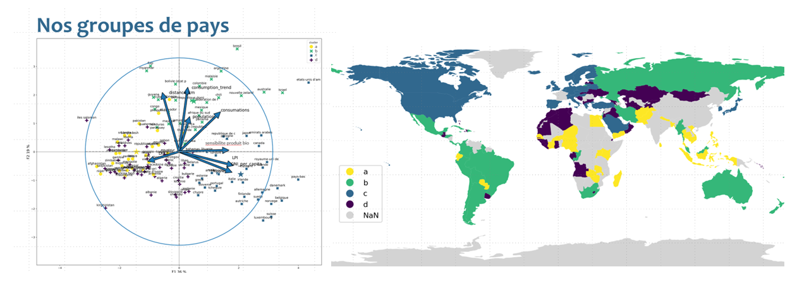
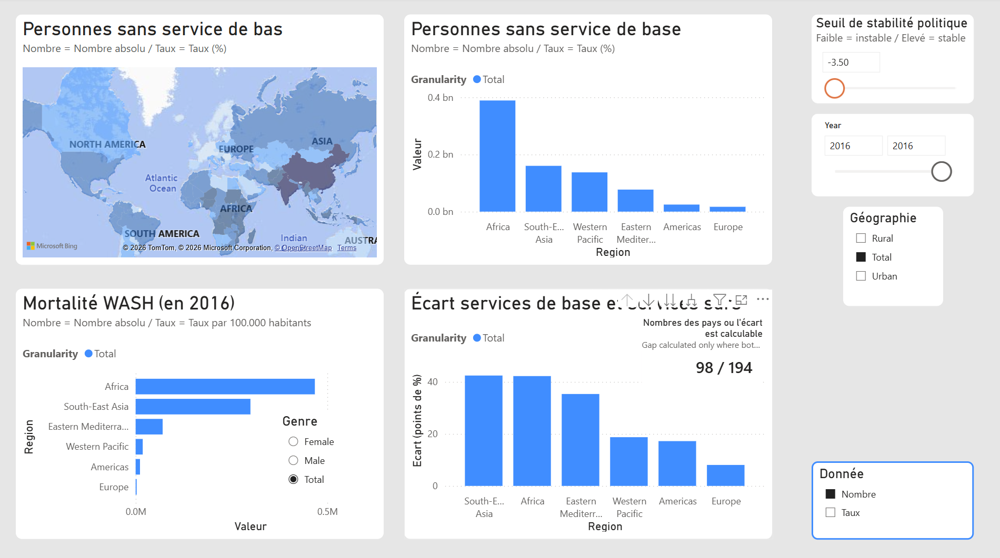
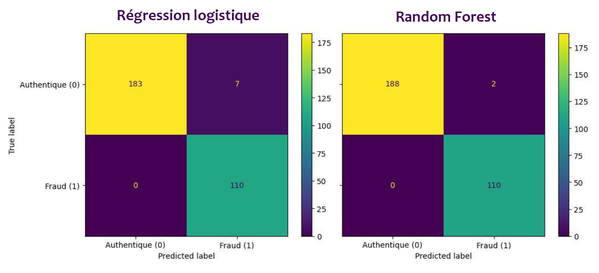
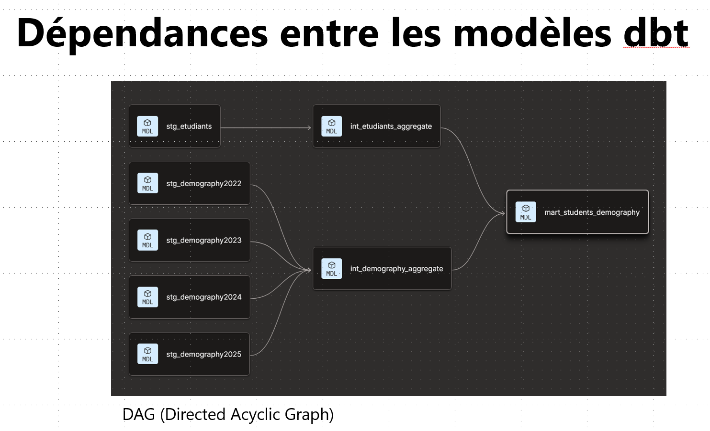
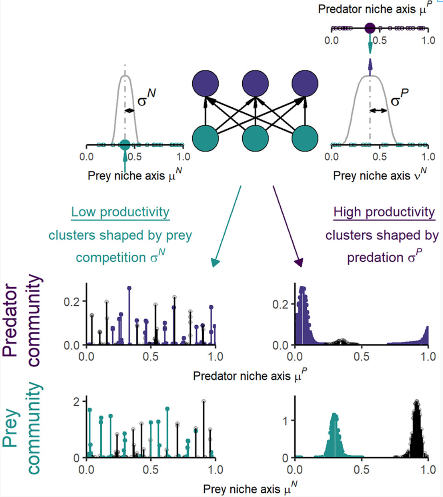
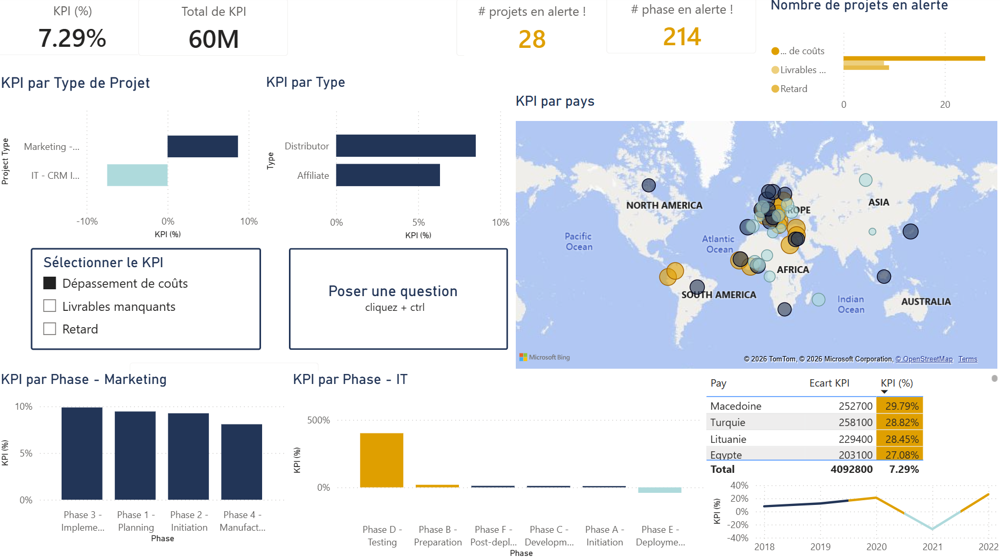
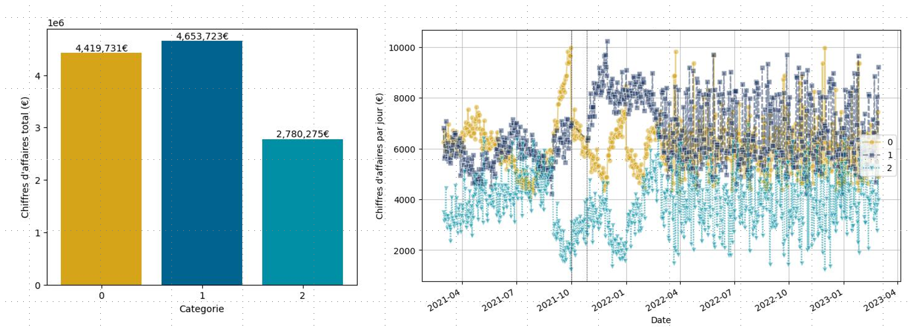
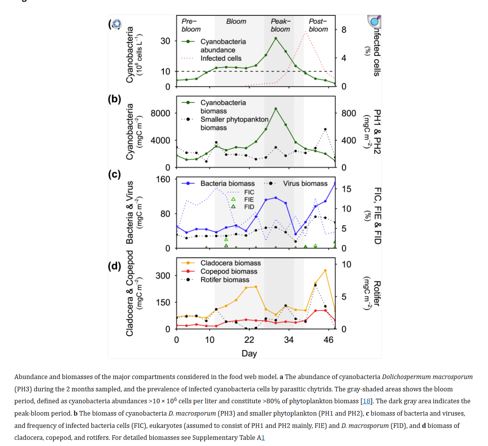
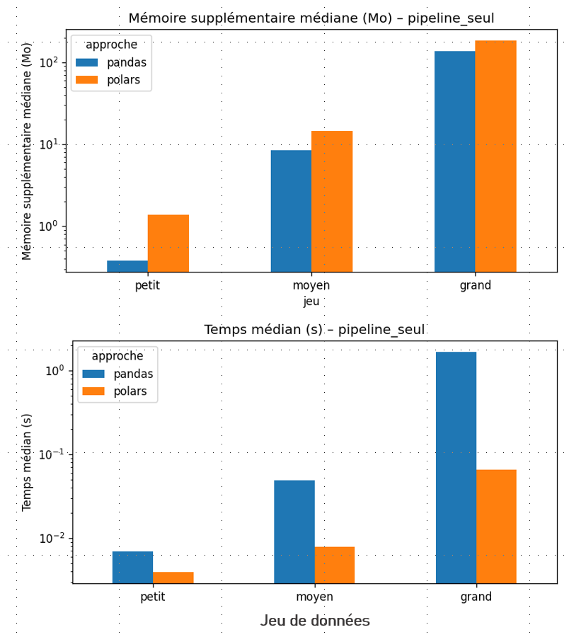

# Tillab.github.io
#### Mon portfolio professionnel

## Projets sélectionnés
### P11 Réaliser une étude de marché — Python
Comment une entreprise en croissance peut-elle identifier les pays à privilégier pour son développement à l’international ? Dans ce projet, j’ai utilisé des méthodes statistiques multivariées — analyse en composantes principales (ACP) et classification non supervisée — pour identifier des groupes de pays présentant des caractéristiques potentiellement favorables au développement du marché d’un produit de poulet à vocation écologique.

[...read more in GitHub repository](https://github.com/Tillab/P11_etude_de_marche_multistat)

 

---

### P10 Analyser l’accès à l’eau potable avec Power BI — Power BI
L’organisation à but non lucratif fictive Drinking Water For All (DWFA) souhaite améliorer l’accès à l’eau potable dans le monde. J’ai développé un tableau de bord interactif sous Power BI afin d’identifier les pays confrontés aux difficultés les plus importantes et d’éclairer la priorisation d’éventuels investissements futurs.

[...read more in GitHub repository](https://github.com/Tillab/P10_acces_eau_potable_Power_BI)

 

---

### Détectez des faux billets avec Machine Learning - python
L’Organisation nationale de lutte contre le faux-monnayage (ONCFM, organisation fictive) cherche à améliorer l’identification des faux billets. À partir d’un jeu de données de 1 500 billets scannés, dont l’authenticité était connue, j’ai entraîné et évalué plusieurs algorithmes de Machine Learning afin d’identifier l’approche la plus adaptée à cette tâche.

[...read more in GitHub repository](https://github.com/Tillab/P12_faix_billets_avec_ML)

 

---

### P8 Étudier l’évolution du profil sociodémographique des étudiants Data d’OpenClassrooms — dbt et Snowflake
La plateforme de formation en ligne OpenClassrooms souhaitait mieux comprendre le profil sociodémographique des étudiants inscrits à ses formations Data. J’ai analysé des données internes d’inscription couvrant la période 2022–2025, que j’ai complétées avec des données démographiques publiques de l’INSEE.

[...read more in GitHub repository](https://github.com/Tillab/P8_profiles_sociodemographic)

 

     

##

### Article Modéliser théoriquement la coexistence des espèces — R

Comprendre comment différentes espèces peuvent coexister dans la nature est une question centrale en écologie depuis plusieurs décennies. Dans ce projet, j’ai exploré une explication théorique de la coexistence à l’aide d’un modèle classique de Lotka-Volterra représentant un réseau trophique à trois niveaux. J’ai simulé la dynamique des prédateurs et des proies sur 500 générations avec des équations différentielles ordinaires sous R, puis analysé les communautés obtenues.

[...read more in GitHub repository](Modeliser_theoriquement_la_coexistence_de_especes)

 

##

### P7 Visualiser dynamiquement l’avancement des projets avec Power BI — Power BI
Pour une entreprise internationale fictive intervenant dans plusieurs pays et continents, j’ai développé un tableau de bord Power BI permettant de suivre l’avancement des projets. L’analyse s’appuie sur des données internes de suivi, notamment les durées prévues et réelles, les coûts et les livrables.

[...read more in GitHub repository](https://github.com/Tillab/P7_visualizer_avancement_projets_Power_BI)

 

##

### P9 Analyser les ventes d’une librairie en ligne — Python
Dans ce projet, j’ai analysé les données de vente d’une librairie en ligne afin de mieux comprendre les comportements d’achat de ses clients. J’ai travaillé à partir de l’historique des ventes et d’informations sur les produits et les clients. Après le nettoyage des données et la sélection d’indicateurs pertinents, j’ai utilisé la visualisation et les statistiques descriptives pour étudier l’évolution des ventes et les profils des clients. J’ai également appliqué des méthodes de statistique inférentielle pour examiner les hypothèses commerciales de l’entreprise.

[...read more in GitHub repository](https://github.com/Tillab/P9_analyse_des_ventes)

 

##

### Modélisation du réseau trophique lors d’une prolifération de cyanobactéries - R
Les proliférations de cyanobactéries sont souvent considérées comme des impasses trophiques, car ces organismes sont peu consommés par les autres organismes aquatiques. Dans le cadre de ce projet interdisciplinaire, j’étais responsable de la modélisation de la dynamique du réseau trophique d’un écosystème aquatique au cours d’une prolifération de cyanobactéries de deux mois.

[...read more in GitHub repository](https://github.com/Tillab/Modelisation_reseau_trophique_cyanobacteria)

 

##

### P13 Optimiser la gestion des données d’une boutique en ligne — Python
Les outils d’intelligence artificielle transforment les pratiques des analystes de données. Dans ce projet, j’ai utilisé un assistant IA de manière critique et méthodique pour améliorer un précédent projet d’analyse consacré à la gestion des données d’une boutique en ligne. J’ai ciblé deux axes : le nettoyage des données et la détection des valeurs aberrantes.

[...read more in GitHub repository](https://github.com/Tillab/P13_ameliorer_projet_data_avec_IA)

 

##

### P5 Créer et interroger une base de données immobilière avec SQL — Databricks
Dans ce projet, j’ai créé une base de données destinée à centraliser les informations sur les transactions immobilières d’un réseau national d’agences. Les données regroupaient des transactions immobilières, des données de population de l’INSEE et des données publiques décrivant les régions françaises.

[...read more in GitHub repository](https://github.com/Tillab/P5_creer_interroger_base_de_donnees_SQL)

##

### Modéliser les réseaux trophiques aquatiques de 16 lacs expérimentaux — R
Dans ce projet de recherche, j’ai modélisé les réseaux trophiques aquatiques de 16 lacs expérimentaux afin d’étudier les effets bottom-up et top-down sur la structure et le fonctionnement des réseaux trophiques. J’ai utilisé des données d’abondance, de biomasse et de taille des espèces de phytoplancton, de zooplancton et de poissons, collectées à cinq dates au cours de trois années.

[...read more in GitHub repository](https://github.com/Tillab/Modeliser_les_reseaux_trophiques_aquatiques)

##
